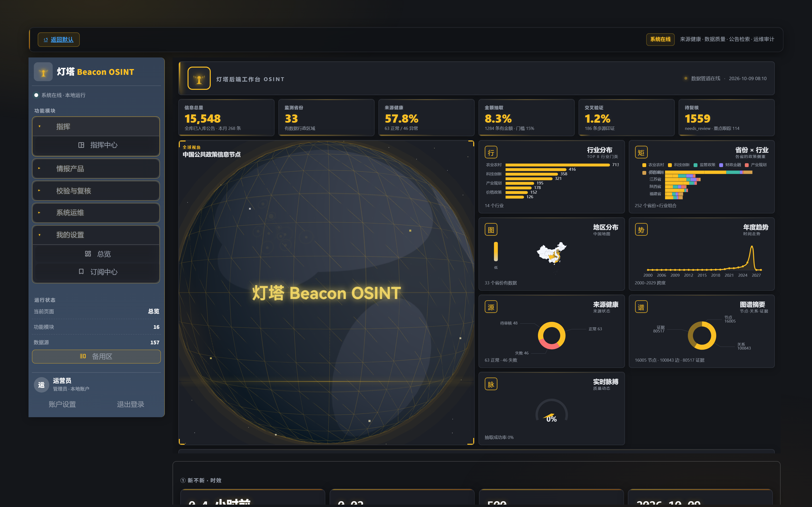
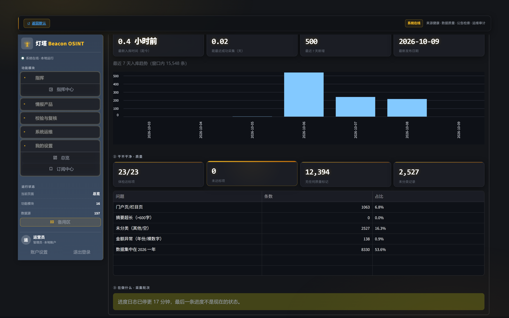
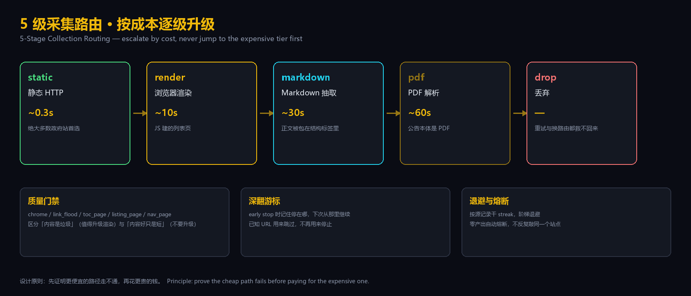
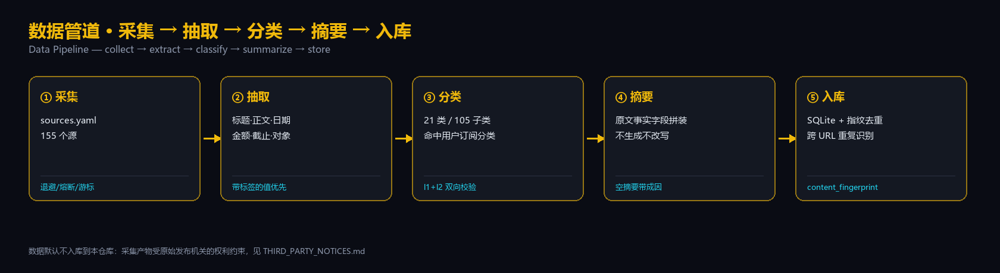

<div align="center">

# 灯塔 Beacon OSINT

**聚焦中国政务公共信息的采集、抽取与归档工具**
**A collection, extraction and archiving toolkit for Chinese government-affairs information**

[](LICENSE)
[](requirements.txt)
[](#-平台说明--platform-notes)

[中文](#中文) · [English](#english)

</div>

---

<a name="中文"></a>

## 中文

### 这是什么

一个**自用**的政务公告采集系统：从国家部委、省级厅局到市级部门的公开栏目，持续抓取政策文件、
通知公告、招标与补贴信息，抽取出结构化字段（发布日期、金额、截止时间、申报对象、分类），
生成可追溯的摘要，并归档成可检索、可比对的本地知识库。

**它不做的事**：不生成内容、不改写原文、不推测缺失字段。所有字段都来自原文中**带标签**的值。
摘要由原文事实字段拼装而成，不是模型改写。

### 界面



**指挥中心** —— 一屏看完采集结果：信息总量、覆盖省份数、来源健康度、金额与交叉验证抽取率，
以及行业分布、省份 × 行业交叉图、地区分布中国地图、年度趋势、来源健康、证据谱系与实时脉搏。



**数据体检** —— 23 项体检指标、问题分类计数，以及当前正在跑的采集轮次。
项目**自己监控自己**：门户页混入、未分类占比、金额异常、数据年份集中度都会被列出来。

### 核心设计



**按成本逐级升级**：绝大多数政府站用静态 HTTP 就能拿到列表（~0.3 秒）。只有当静态路径
**被证明走不通**时，才升级到浏览器渲染（~10 秒）、Markdown 抽取（~30 秒）、PDF 解析（~60 秒）。
一上来就用最贵的手段是浪费——也对站点不友好。

三条配套机制让这条链路真正跑得起来：

- **质量门禁** —— 区分「内容是垃圾」（值得升级到更贵的渲染）和「内容好只是短」
  （**不要**升级，渲染不会让 300 字的通告变长）。
- **深翻游标** —— 列表页按时间倒序，最新的在最前面。若只是「连续遇到 N 个已知 URL 就收工」，
  每一轮都会重爬同一段已知内容、每轮都得出同一个「无新内容」的结论。改为记住停在哪、
  下次从那里继续。
- **退避与熔断** —— 按源记录干 streak，阶梯退避，零产出自动熔断。不反复敲同一个站点。



### 快速开始

```bash
git clone https://github.com/matou1118/beacon-osint.git
cd beacon-osint

# Python 3.10+
pip install -r requirements.txt
playwright install chromium

# 启动界面（首次启动会自动建库）
streamlit run app.py
```

单独跑一轮采集：

```bash
# 试跑：只报告不落库
python lighthouse/run.py --dry-run --sources moa_gov --archive-pages 30

# 正式：写入数据库
python lighthouse/run.py --sources moa_gov --archive-pages 30
```

数据分析与自检：

```bash
python scripts/status_summary.py     # 采集状态汇总
python scripts/data_health.py        # 24 项数据健康指标
python scripts/reconcile_check.py    # 库内数据与源现状核对
pytest tests lighthouse/tests        # 688 项测试
```

### 目录结构

```
collectors/     多来源采集器（HTML / API / RSS / 媒体）
lighthouse/     采集路由、质量门禁、字段抽取、退避熔断、无人值守调度
extractors/     正文抽取、摘要构建、附件下载、分类规则
storage/        SQLite 持久化、指纹去重
config/         sources.yaml（源清单）、categories.yaml（分类体系）
rules/          订阅规则匹配
api/            FastAPI 只读接口
scripts/        运维与自检脚本
tests/          688 项测试
docs/images/    README 用图
```

### 采集哪些信息

| 层级 | 覆盖 |
|---|---|
| **国家部委** | 医保、知识产权、自然资源、市场监管、统计、人民银行 … |
| **省级厅局** | 市场监管、发改、工信、农业农村、生态环境 … |
| **市级部门** | 苏州工信、深圳住建、南京发改 … |

当前 **155 个源**，覆盖 **33 个省级行政区**。源清单在 `config/sources.yaml`，
每个源都经过「探列表页 + 实跑抽取」双重验证后才启用。

### 分类体系

21 个一级分类 / 105 个二级分类，定义在 `config/categories.yaml`。
`category_l1` 与 `category_l2` **必须**命中——`tests/test_category_taxonomy.py`
同时校验两个层级，规则表产出但分类表没登记的子类会被测试直接拦下。

### 平台说明

**Windows 是主要开发与运行环境。** 无人值守采集依赖 Windows 任务计划程序与
`pythonw`（`lighthouse/winflags.py`、`lighthouse/watchdog.py`）。
核心采集逻辑（`collectors/`、`lighthouse/routes.py`、`lighthouse/quality.py`、
`extractors/`）是纯 Python，**Linux/macOS 上可以跑**，但任务计划与进程组那部分是 Windows 专属。

---

<a name="english"></a>

## English

### What this is

A **personal-use** collection system for Chinese government-affairs information: it
continuously crawls policy documents, notices, tenders and subsidy announcements from
ministries, provincial departments and municipal bureaus; extracts structured fields
(publication date, amount, deadline, target group, category); produces traceable
summaries; and archives everything into a searchable local knowledge base.

**What it does not do**: it never generates content, never rewrites the source text,
and never guesses missing fields. Every field comes from a **labelled** value in the
original document. Summaries are assembled from factual fields — not model paraphrase.

### Dashboard


The **command centre** shows everything at a glance: total records, provinces covered,
source health, amount and cross-verification extraction rates, plus industry
distribution, a province × industry matrix, a China region map, yearly trends, source
health, the evidence spectrum, and a live pulse.


**Data health** — 23 health metrics, a categorised issue table, and the collection round
currently running. The project **monitors itself**: portal-page contamination, unclassified
share, malformed amounts and year concentration are all surfaced rather than hidden.

### Core design


**Escalate by cost.** The vast majority of government sites serve their list pages over
plain HTTP (~0.3s). Only when the cheap path is **proven** to fail does the ladder escalate
to browser rendering (~10s), Markdown extraction (~30s), and PDF parsing (~60s).
Starting at the expensive tier wastes budget and hammers the site.

Three supporting mechanisms make the ladder actually work:

- **Quality gate** — separates "this content is garbage" (worth escalating to a pricier
  renderer) from "this content is fine, just short" (do **not** escalate; rendering will
  not make a 300-word notice longer).
- **Deep-paging cursor** — list pages are newest-first. If we simply stop after N
  consecutive known URLs, every round re-crawls the same known prefix and reaches the same
  "nothing new" conclusion. Instead we remember where we stopped and resume past it.
- **Backoff and circuit breaking** — per-source dry-streak tracking, laddered backoff, and
  automatic circuit breaking. Do not knock on the same door repeatedly.


### Quick start

```bash
git clone https://github.com/matou1118/beacon-osint.git
cd beacon-osint

# Python 3.10+
pip install -r requirements.txt
playwright install chromium

# Launch the UI (the database is created on first run)
streamlit run app.py
```

Run a single collection round:

```bash
# Dry run: report only, no writes
python lighthouse/run.py --dry-run --sources moa_gov --archive-pages 30

# Real run: writes to the database
python lighthouse/run.py --sources moa_gov --archive-pages 30
```

Analysis and self-checks:

```bash
python scripts/status_summary.py     # collection status summary
python scripts/data_health.py        # 24 data-health metrics
python scripts/reconcile_check.py    # reconcile stored data against live sources
pytest tests lighthouse/tests        # 688 tests
```

### Repository layout

```
collectors/     Multi-source collectors (HTML / API / RSS / media)
lighthouse/     Routing, quality gate, field extraction, backoff, unattended scheduling
extractors/     Body extraction, summary assembly, attachment download, classification
storage/        SQLite persistence, fingerprint dedup
config/         sources.yaml (source list), categories.yaml (taxonomy)
rules/          Subscription rule matching
api/            FastAPI read-only interface
scripts/        Operations and self-check scripts
tests/          688 tests
docs/images/    README artwork
```

### What is collected

| Level | Coverage |
|---|---|
| **National ministries** | Healthcare Security, Intellectual Property, Natural Resources, Market Regulation, Statistics, PBOC … |
| **Provincial departments** | Market Regulation, NDRC, Industry & IT, Agriculture, Ecology … |
| **Municipal bureaus** | Suzhou II&T, Shenzhen Housing, Nanjing NDRC … |

**155 sources** covering **33 provincial-level administrative regions**. Every source in
`config/sources.yaml` passed both a list-page probe and a real extraction run before
being enabled.

### Taxonomy

21 top-level categories / 105 subcategories, defined in `config/categories.yaml`.
Both `category_l1` and `category_l2` **must** match — `tests/test_category_taxonomy.py`
validates both levels, so a subcategory the classifier can emit but the taxonomy does not
declare fails the test suite outright.

### Platform notes

**Windows is the primary development and runtime platform.** Unattended collection relies on
Windows Task Scheduler and `pythonw` (`lighthouse/winflags.py`, `lighthouse/watchdog.py`).
The core collection logic (`collectors/`, `lighthouse/routes.py`, `lighthouse/quality.py`,
`extractors/`) is pure Python and **runs on Linux/macOS**, but the scheduling and
process-group parts are Windows-only.

---

## 许可与数据 / License and data

- 本项目采用**非商用许可证**：允许使用、修改、再分发、二次开发，**禁止任何商业用途**。
  See [`LICENSE`](LICENSE). Non-commercial: use, modify, redistribute and fork freely —
  **no commercial use**.
- 第三方组件（ECharts / three.js / 行政区划 GeoJSON）适用其各自许可，见
  [`THIRD_PARTY_NOTICES.md`](THIRD_PARTY_NOTICES.md)。
- **本仓库不包含任何采集到的政务公告原文或数据库**（见 `.gitignore`）。此类内容的著作权
  由原始发布机关决定。使用者须自行遵守目标站点的 robots 协议、服务条款与适用法律。
  **No collected documents or databases are distributed with this repository.**

## 文档 / Documentation

- [`CHANGELOG.md`](CHANGELOG.md) — 版本演进 / release history
- [`AGENTS.md`](AGENTS.md) — 工程约定与踩坑记录 / engineering conventions & hard-won lessons
- [`PRODUCT.md`](PRODUCT.md) — 产品定位 / product positioning
- [`docs/`](docs/) — 设计文档 / design documents
- [`.opencode/skills/`](.opencode/skills/) — 方法论：measure-before-fix、no-test-equals-data